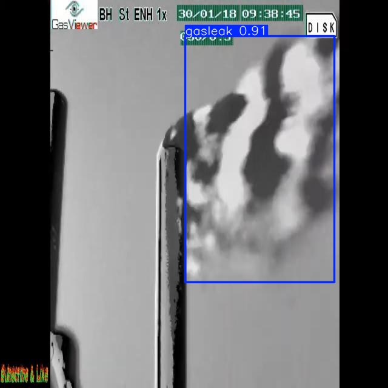
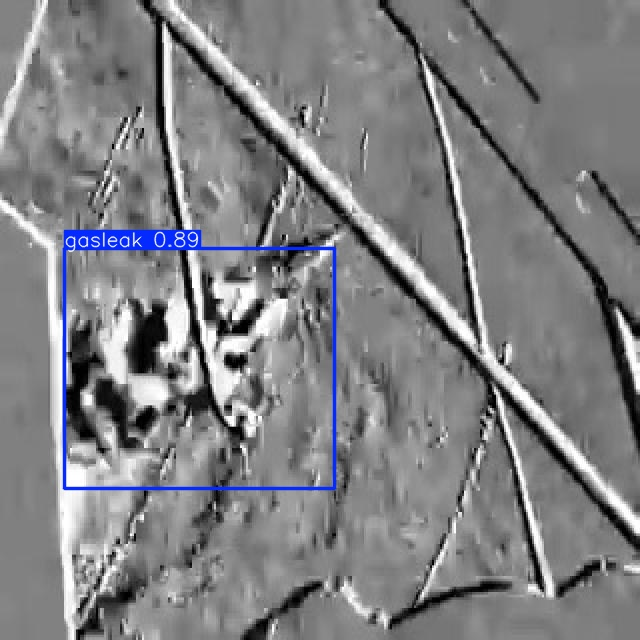
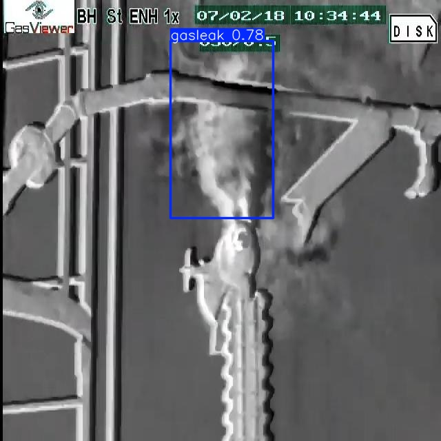
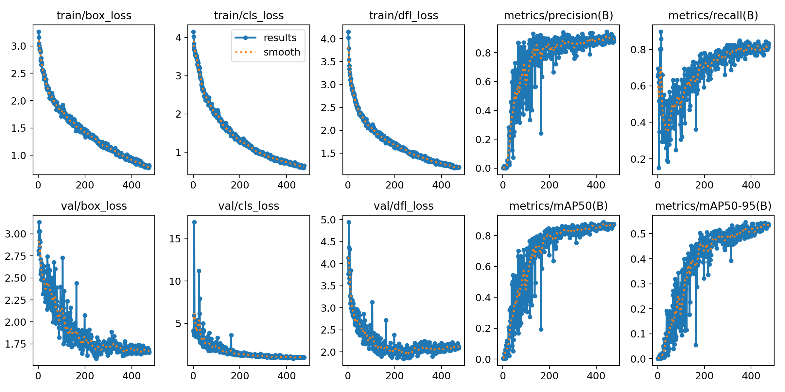
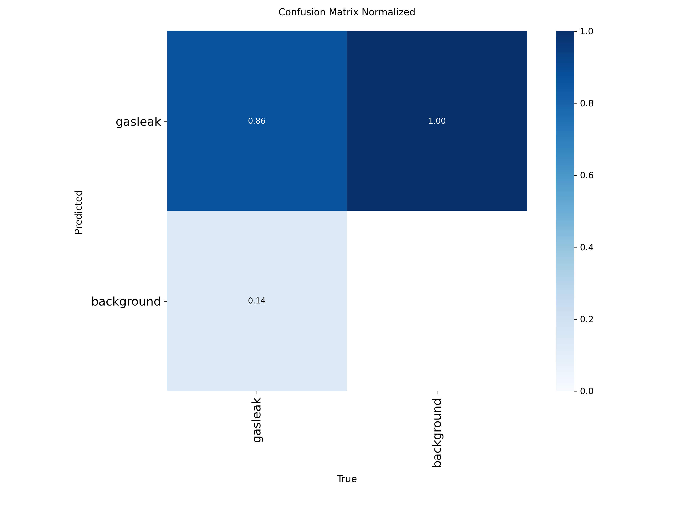
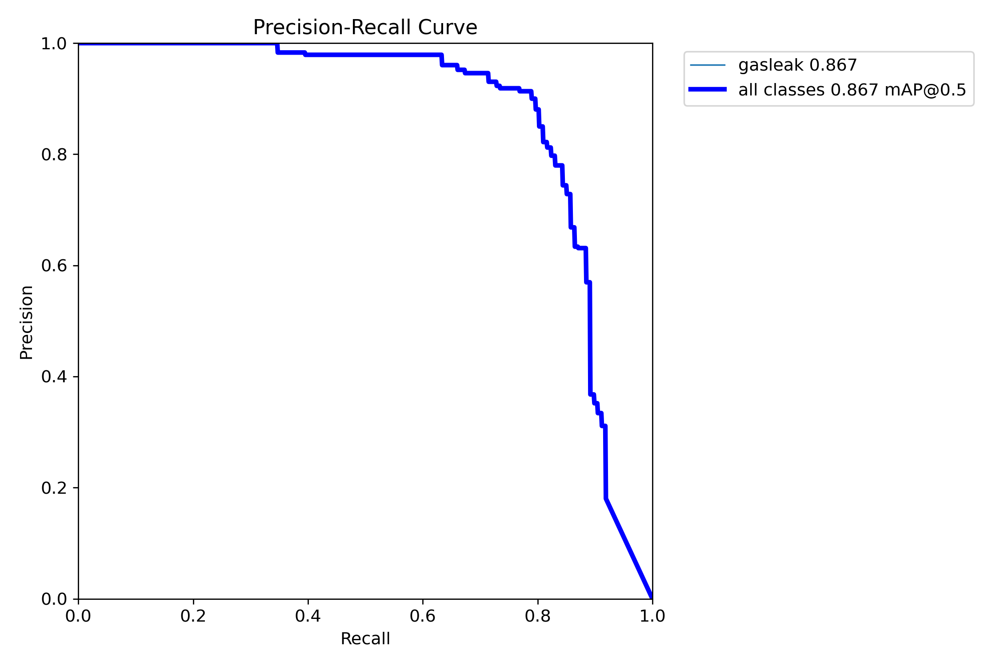
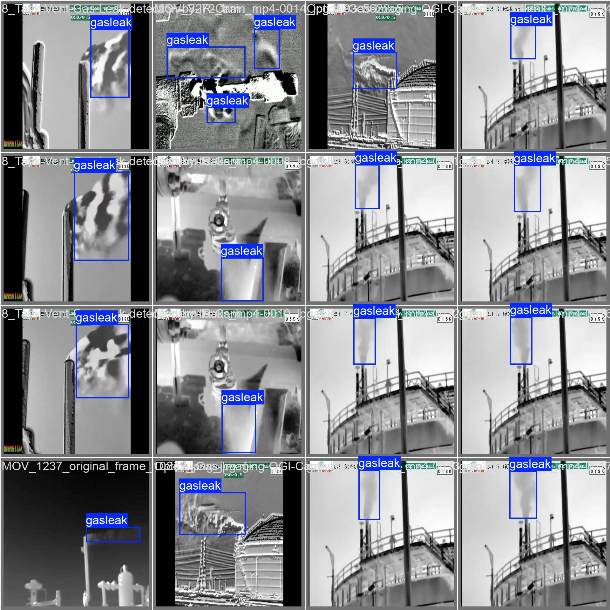
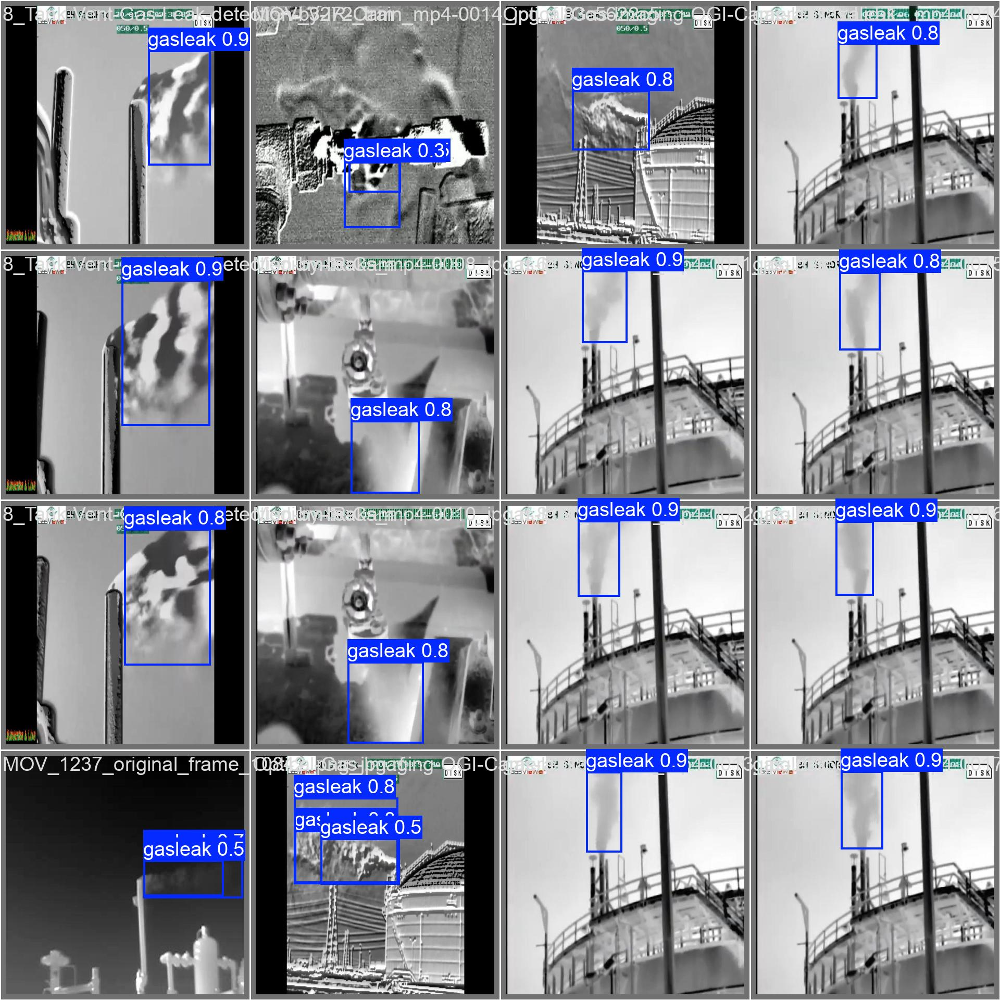

# Projeto Integrador 4 - Gasleak

**IA para detecção e monitoramento de vazamento de gás em plataformas de petróleo usando visão computacional.**

Projeto Integrador 4 (FAESA, 2026.02), com base no trabalho da optativa *Uso de Inteligência Artificial na Descarbonização* (D010397).

<p align="center">
  
  
  
</p>

## Contexto

As **emissões fugitivas** (vazamentos em tubulações, flanges, válvulas, instrumentos, selos de bomba, juntas e conexões) estão entre as principais fontes de gases de efeito estufa (GEE) na indústria de óleo e gás, ao lado da queima em tocha (*flaring*), do *venting* e da geração de energia a bordo.

As soluções tradicionais (detectores portáteis de lapela, detectores fixos, ultrassom, sensores eletroquímicos e analisadores de metano) são pontuais: só detectam o gás que chega até o sensor. As **câmeras OGI** (*Optical Gas Imaging*) tornam a pluma de gás visível, captando no infravermelho o contraste térmico entre o gás e o ambiente, mas ainda dependem de um operador olhando a imagem.

**Proposta:** treinar um modelo de detecção de objetos (YOLO) que identifique automaticamente plumas de vazamento de gás em imagens e vídeos de câmeras OGI/térmicas, viabilizando o monitoramento contínuo e alarmes automáticos.

## Como funciona

```
Câmera OGI / vídeo / imagem ──► YOLOv8s (classe "gasleak") ──► caixas + confiança ──► alerta
```

| Item | Escolha |
|---|---|
| Técnica | Visão computacional, detecção de objetos |
| Algoritmo | YOLOv8s (Ultralytics), classe única `gasleak` |
| Ambiente | Google Colab com GPU |
| Bibliotecas | Ultralytics, OpenCV |
| Dataset | Imagens de vazamentos anotadas no Roboflow (ver [`data/`](data)) |
| Versão anterior | YOLOv4 com Darknet e OpenCV ([notebooks](notebooks/yolov4), [configs](configs/darknet) e [scripts](src/darknet)) |

O projeto evoluiu em duas etapas: primeiro um detector **YOLOv4** treinado com Darknet e executado com OpenCV; depois o modelo final em **YOLOv8s** (Ultralytics), que é o descrito nos resultados abaixo.

## Resultados

Treino de **500 épocas** (imgsz 640, batch 16, partindo do zero com `yolov8s.yaml`), com *early stopping* na época 475 (paciência 100). O melhor modelo ([`weights/best.pt`](weights/best.pt)) é o da **época 375**:

| Precisão | Recall | mAP@50 | mAP@50-95 |
|:---:|:---:|:---:|:---:|
| 0,905 | 0,789 | 0,866 | 0,546 |

Tempo total de treino: cerca de 76 min. Curvas de perda e métricas por época estão em [`results/treinamento`](results/treinamento).



| Matriz de confusão (normalizada) | Curva Precisão × Recall |
|---|---|
|  |  |

| Rótulos reais (validação) | Predições do modelo |
|---|---|
|  |  |

As curvas F1, P e R e a distribuição dos rótulos (`labels.jpg`) também estão em [`results/treinamento`](results/treinamento).

O vídeo com o resultado da detecção está na [pasta do projeto no Google Drive](https://drive.google.com/drive/folders/1fbmdwq0HorSvJ0A4UIHge39IE8-hVHQb).

## Estrutura do repositório

```
├── notebooks/        # notebooks do Colab (sem saídas)
│   ├── YOLOv8_Treinamento_Customizado_GasLeak.ipynb   # treino do modelo final
│   ├── dataset/      # criação do dataset e conversão das anotações
│   ├── yolov4/       # detecção em imagens e vídeos com Darknet e OpenCV
│   └── yolov8/       # exploração do YOLOv8 (detecção, validação, segmentação)
├── src/
│   ├── train.py      # treino com os mesmos parâmetros do Colab
│   ├── detect.py     # inferência em imagem, vídeo, pasta ou câmera
│   └── darknet/      # scripts de preparação do dataset para o YOLOv4
├── configs/
│   ├── yolov8/       # configs_modelo.yaml (dataset) e args.yaml (hiperparâmetros do treino)
│   └── darknet/      # yolov4_custom.cfg, obj.data e obj.names
├── weights/
│   └── best.pt       # modelo treinado (YOLOv8s, 22 MB)
├── results/
│   ├── treinamento/  # results.csv, curvas e lotes de validação
│   └── exemplos/     # imagens de teste com as detecções
└── data/             # instruções para baixar o dataset (não versionado)
```

## Como usar

### No Google Colab (recomendado para treinar)

Abra o [notebook no Colab](https://colab.research.google.com/drive/1HVmY2yG92IVbBllGE5xDI1HWjclknZVJ) ou a cópia em [`notebooks/`](notebooks), selecione um ambiente com GPU e execute as células em ordem. O notebook espera os arquivos `obj.zip` (treino) e `valid.zip` (validação) em `MyDrive/GasLeak/`, disponíveis na [pasta do Google Drive](https://drive.google.com/drive/folders/1fbmdwq0HorSvJ0A4UIHge39IE8-hVHQb).

### Localmente

```bash
git clone https://github.com/RoberliSchuina/Projeto-Integrador-4-Gasleak.git
cd Projeto-Integrador-4-Gasleak
pip install -r requirements.txt
```

Detectar vazamentos com o modelo treinado:

```bash
python src/detect.py --source results/exemplos/deteccao_04.jpg
python src/detect.py --source video.mp4 --conf 0.4
python src/detect.py --source 0 --show        # câmera conectada ao computador
```

As saídas são salvas em `runs/detect/`. Treinar novamente (veja [`data/README.md`](data/README.md) para baixar o dataset):

```bash
python src/train.py --epochs 500 --export-onnx
```

### Notebooks

| Notebook | O que faz |
|---|---|
| [`YOLOv8_Treinamento_Customizado_GasLeak`](notebooks/YOLOv8_Treinamento_Customizado_GasLeak.ipynb) | Treino, validação, testes em imagens e vídeos e exportação para ONNX do modelo final |
| [`dataset/Criando_dataset_Darknet`](notebooks/dataset/Criando_dataset_Darknet.ipynb) | Coleta das imagens, conversão das anotações e geração dos arquivos `.cfg`, `obj.data`, `train.txt` e `test.txt` |
| [`yolov4/Deteccao_imagens_Darknet`](notebooks/yolov4/Deteccao_imagens_Darknet.ipynb) | Detecção em imagens com YOLOv4 e Darknet |
| [`yolov4/Deteccao_videos_Darknet_GPU`](notebooks/yolov4/Deteccao_videos_Darknet_GPU.ipynb) | Detecção em vídeos com Darknet (GPU) |
| [`yolov4/Deteccao_imagens_OpenCV_CPU`](notebooks/yolov4/Deteccao_imagens_OpenCV_CPU.ipynb) | Detecção em imagens com o módulo DNN do OpenCV (CPU) |
| [`yolov4/Deteccao_videos_OpenCV_modelo_treinado`](notebooks/yolov4/Deteccao_videos_OpenCV_modelo_treinado.ipynb) | Detecção em vídeos com OpenCV usando o modelo YOLOv4 treinado |
| [`yolov8/Exploracao_YOLOv8_GPU`](notebooks/yolov8/Exploracao_YOLOv8_GPU.ipynb) | Testes com o YOLOv8: limiar, múltiplas imagens, validação, vídeos e segmentação |

### Pipeline YOLOv4/Darknet

Os scripts em [`src/darknet`](src/darknet) preparam o dataset no formato do Darknet:

- `converter_annotations.py` converte as anotações (XMin, YMin, XMax, YMax) para o formato normalizado do YOLO, usando as classes de `classes.txt`;
- `gerar_train.py` e `gerar_test.py` geram as listas `train.txt` e `test.txt` a partir de `data/obj` e `data/valid`.

O treino usa [`configs/darknet/yolov4_custom.cfg`](configs/darknet/yolov4_custom.cfg) (entrada 608×608, 1 classe).

## Desafios e próximos passos

- **Dados:** há poucas imagens públicas de vazamentos em câmeras OGI. O dataset foi montado a partir de fontes públicas (TensorFlow, ImageNet, Kaggle, GitHub, Google) e anotado manualmente.
- **Generalização:** o recall de 0,79 indica que parte das plumas ainda escapa. Ampliar o dataset com vídeos reais de plataformas e testar transfer learning (`--model yolov8s.pt`) são caminhos naturais.
- **Implantação:** rodar o modelo em ONNX na borda (junto à câmera) e integrar os alertas a um sistema de supervisão.

## Links

- Notebook no Colab: https://colab.research.google.com/drive/1HVmY2yG92IVbBllGE5xDI1HWjclknZVJ
- Datasets públicos no Roboflow Universe (CC BY 4.0): [detecção](https://universe.roboflow.com/roberli/gas-leak-x7van-qfi52/dataset/1) e [segmentação](https://universe.roboflow.com/roberli/gas-leak-ka6fi-uahui/dataset/1)
- Arquivos do projeto (vídeos, pesos, dataset zipado): https://drive.google.com/drive/folders/1fbmdwq0HorSvJ0A4UIHge39IE8-hVHQb
